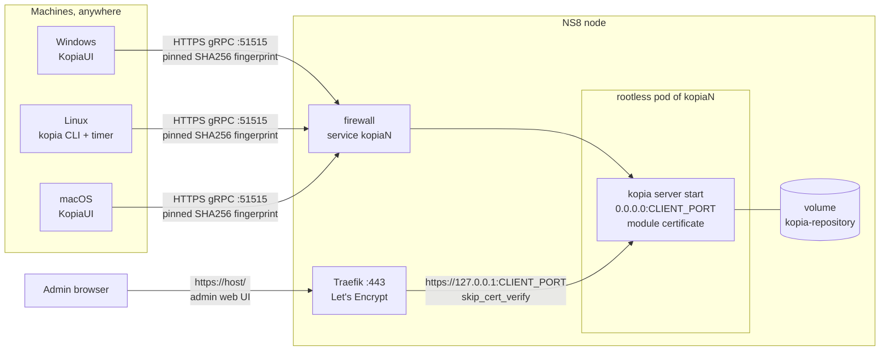
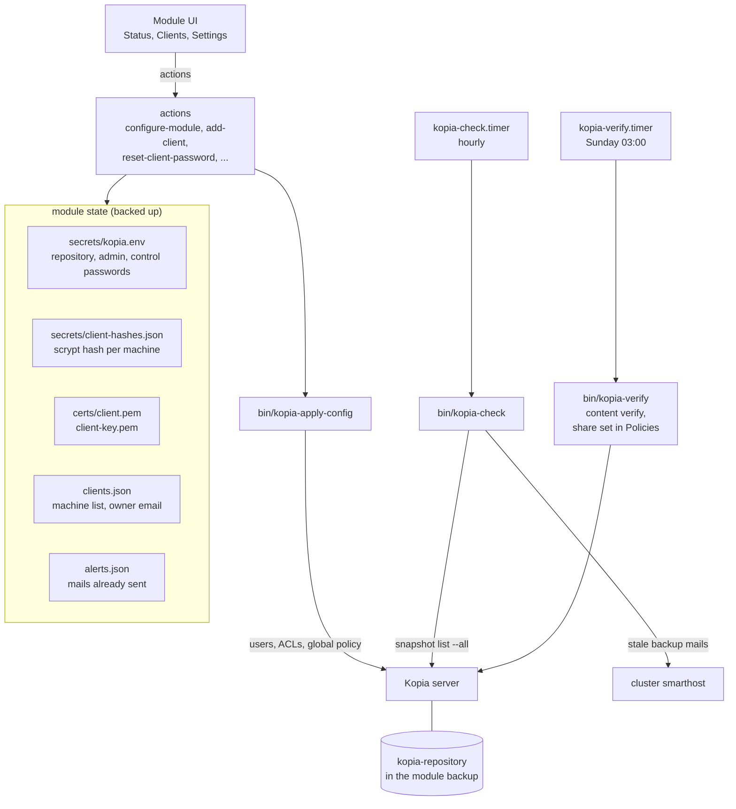
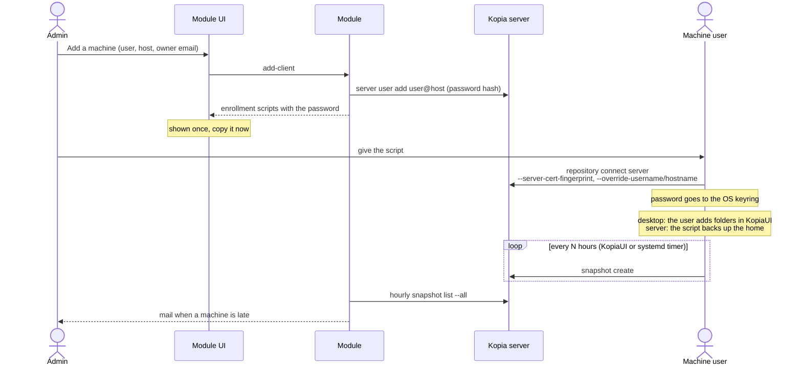

# ns8-kopia

A [Kopia](https://kopia.io) repository server for [NethServer 8](https://github.com/NethServer/ns8-core).
Your Windows, Linux and macOS machines back up to NS8 with the Kopia client or KopiaUI.
The module adds what Kopia lacks: machine accounts managed from the UI, central backup
policies, a status per machine, and mail alerts when a machine stops backing up.

One instance serves one company: ACLs keep the machines apart inside one repository.
Run several instances on one node only to host several customers, each with its own
repository, password, disk and port.

## How it works

### Network



Machines connect straight to Kopia on its own public port, 51515 by default. They never go
through Traefik: its 60 second read timeout cuts any backup longer than one minute, because
Kopia keeps one gRPC stream for the whole backup.

On that port Kopia serves TLS with a module certificate, self-signed, valid 10 years. Machines
pin its SHA256 fingerprint, so a host name change or a Let's Encrypt renewal never breaks
them. Traefik serves only the admin web UI on 443, with Let's Encrypt if you ask for it. The
same web UI also answers on the client port, behind the same admin login.

Clients only connect outbound. Open nothing on the machines. On the NS8 side, the module opens
the client port in the firewall. If the server is behind NAT, forward that port on the router.
A laptop on a network that allows only 80 and 443 cannot back up there. It catches up later,
and the stale backup alert covers the gap.

### Architecture



The module state is the source of truth. Kopia keeps its users in the repository, but the
repository can miss some: an account created while the backup copied the repository, or a
backup taken before the repository was in it. So `kopia-apply-config` pushes the state into Kopia:
it creates missing accounts with their stored hash, resets the ACLs if they drifted, and sets
the global policy. It never deletes an account. Only `remove-client` does that. It runs after
`configure-module`, `update-module` and a restore.

The server runs maintenance itself, under the fixed identity `server@kopia` set when the
repository is created, so a host change does not stop it.

### Machines



Each machine has its own account `user@host` and its own random password. The module keeps
only the scrypt hash of that password. The password appears once, inside the enrollment
script returned when the machine is added or its password reset. The core keeps that task
output for about 8 hours, readable by cluster admins only. They can read the repository
password anyway.

To reinstall a machine, reset its password and run the new script. The machine gets the same
identity, so it finds its old snapshots. Until the new script runs, the old password in its
keyring stops working.

Default ACLs: a machine sees and creates only its own snapshots, and cannot delete any. It
reads its policies, the host policy and the global policy. It can append content to the
repository, which every backup needs. It cannot change any policy or its own account. Old
snapshots still expire: after each snapshot the machine asks the server to apply the
retention of the policy, and the server deletes them. A machine that stops backing up keeps
its last snapshots. Anyone holding the script can read and restore the backups of that
machine, from anywhere, but not delete them directly. This is no full guard: a machine sets
the time of its own snapshots, so a stolen script can create fake ones that push the real
ones out of the retention. The cluster backup, with its own retention, is the fallback. If a
script leaks, reset the password.

The ACLs protect the policies in the repository, not the machine itself. Its user can still
leave out any folder: Kopia reads a `.kopiaignore` file in each folder it backs up, with
gitignore rules, and that file never goes through the server. The same user can also stop
KopiaUI or disconnect from the repository. The module cannot force a machine to back up, it
can only notice it: the late backup alerts cover a machine that stops. Back up the folders
that matter, such as a shared accounting folder, from a server, not from a user machine.

The clients are covered in the next section.

### Alerts

`kopia-check` runs every hour and computes the age of the newest complete snapshot of each
machine. A machine that never backed up counts from the day its account was created. A
desktop backs up nothing until its user adds folders in KopiaUI, so a machine left without
folders gets the late mails too, as expected.

One mail goes out when a threshold is crossed, never one per run. A machine that comes back
from the admin level to the owner level gets no mail: it backed up once, but it is still late.

| Mail | Subject (English) | Sent to | When |
| --- | --- | --- | --- |
| Owner late | `Backup late: <machine>` | owner email of the machine | last backup reaches the owner threshold (default 48 h) |
| Admin late | `Backup late: <machine> (<hours> h)` | admin recipients | last backup reaches the admin threshold (default 96 h) |
| Back to normal | `Backup back to normal: <machine>` | owner, plus admins if they were warned | a new backup brings the age under the owner threshold |
| Verification failed | `Backup verification failed on <host>` | admin recipients | the weekly `kopia content verify` finds errors |
| Test | `Kopia test mail from <host>` | the address typed on the Alerts page | the admin clicks "Send test mail" |

Mails go through the cluster smarthost, from `noreply@<host>` unless a sender is set, in the
language chosen in Settings: en, fr, it, de, es, pt, pt_BR or eu. Without a smarthost no mail
leaves, and the states stay visible on the Clients and Status pages.

When more than 3 GB are free at creation, the volume gets a 1 GB file,
`RESERVED-SPACE-delete-if-disk-full`. Delete it to give Kopia room when the disk is full. A
full disk can damage a filesystem repository.

## Install

```sh
add-module ghcr.io/stephdl/kopia:latest 1
```

The output of the command returns the instance name, for example `kopia1`.

## Configure

The module UI has three pages for this:

- **Settings**: host, Let's Encrypt for the admin web UI, client port, admin password and the
  repository password.
- **Policies**: the global policy of every machine (schedule, retention, compression,
  excludes) and the share of data read by the weekly integrity check.
- **Alerts**: owner and admin thresholds, recipients, sender, language, and a
  test mail.

Each page saves only its own fields. From the command line, send only the fields to change.
The first configuration needs `host`, `admin_password` and `repository_password`:

```sh
api-cli run module/kopia1/configure-module --data - <<'EOF'
{
  "host": "kopia.example.org",
  "lets_encrypt": true,
  "client_port": 51515,
  "admin_password": "Admin-pass-2026",
  "repository_password": "Write-it-down-2026",
  "admin_recipients": ["it@example.org"]
}
EOF
```

The repository is created at the first configuration. Its password is chosen by the admin and
cannot be recovered: without it every backup is lost. Write it down outside the server. It
can be shown again from Settings, but it never changes: every module backup holds it, so a
backup taken before a change could not open the repository. If it leaks, install a new
instance and enroll the machines again.

Choose the host and the client port before the first machine. Both are in the URL of every
enrolled machine, so the module refuses to change them while machines exist.

The client port must be free on the node and outside the NS8 port allocator range
(20000 to 45000). A second instance on the same node starts on the next free port.

Defaults of the global policy: a snapshot every 4 hours (0 means manual only), keep the
latest 10, 48 hourly, 14 daily, 8 weekly, 12 monthly and 2 annual snapshots, zstd
compression, and common excludes such as caches, temp folders, trash, `node_modules` and
Windows swap files. Admin and repository passwords take 12 to 64 characters with an
uppercase letter, a lowercase letter, a digit and a symbol among `.,_+:@%^=~-`.

The weekly integrity check runs on Sunday at 03:00. It always checks the index and that every
pack exists, then downloads and checks the share of data set on the Policies page
(`verify_percent`, 10 % by default, 0 to 100). At 10 % the whole repository is read again
within a few months. A check stops after 6 days and 23 hours: the Status page then shows it
as not finished, with no error mail, and you should lower the share.

Saving the settings restarts the server only when the host, the port, the image, a password
or the certificate changed, since a restart cuts the running backups.

All fields are listed in
[configure-module/validate-input.json](imageroot/actions/configure-module/validate-input.json).
The web UI user is always `admin`.

## Enroll a machine

### 1. Install the Kopia client

Follow the Kopia installation guide: <https://kopia.io/docs/installation/>. Use the same
version as the server when you can (0.23.1 today).

| System | Install | What the module script needs |
| --- | --- | --- |
| Windows | KopiaUI ([guide](https://kopia.io/docs/installation/#windows-gui-installation)) or `winget install -e --id Kopia.KopiaUI` | nothing: the script installs KopiaUI with winget when it is missing |
| Linux desktop | KopiaUI from the [APT or RPM repositories](https://kopia.io/docs/installation/#linux-installation-using-apt-debian-ubuntu) | KopiaUI, which schedules the snapshots. With the `kopia` command only, use the Linux server script |
| Linux server | `kopia` from the [APT or RPM repositories](https://kopia.io/docs/installation/#linux-installation-using-apt-debian-ubuntu) | the `kopia` command in the PATH, a systemd user session, and lingering (`loginctl enable-linger <user>` as root if the script cannot enable it) |
| macOS | KopiaUI ([guide](https://kopia.io/docs/installation/#macos-gui-installer)) | KopiaUI in `/Applications`, which schedules the snapshots |

KopiaUI and the CLI share the same config file, so KopiaUI shows a machine enrolled by the
script.

KopiaUI lives in the tray, and it only opens its window by itself while no repository is
connected. After the enrollment it starts hidden: click its tray icon to open it, and pick
**Launch At Startup** in the icon menu so the scheduled snapshots run after each login.
On Windows the icon may hide behind the `^` arrow of the notification area. GNOME has no
tray, so KopiaUI keeps running with no way to open it. Ubuntu ships the AppIndicator extension
that brings it back. On Fedora, Debian and other GNOME systems, install and enable it:

```sh
sudo dnf install gnome-shell-extension-appindicator   # Fedora, Rocky
sudo apt install gnome-shell-extension-appindicator   # Debian
# log out and back in, GNOME Shell only sees new extensions in a new session
gnome-extensions enable appindicatorsupport@rgcjonas.gmail.com
```

### 2. Create the machine account

In the module UI, open **Clients**, click **Add a machine**, and fill in:

- **User name** and **host name**: the Kopia identity of the machine, `user@host`. Lowercase
  letters, digits, dot, dash and underscore. Use one account per machine, for example
  `accounting@pc-accounting-01`.
- **Owner email** (optional): this person gets the first mail when the machine stops backing up.

The page then shows the enrollment script, with three tabs: Windows (PowerShell), Linux and
macOS desktop (shell), and Linux server (shell, for a machine without KopiaUI). **Copy it
now**: it holds the password of the machine and is shown only once. Later, **Connection
details** shows the URL, the certificate fingerprint and the identity, without the password.
To get a script again, reset the password.

### 3. Run the script on the machine

Run it as the user who owns the files, in that user's session. Do not run it as administrator,
root or SYSTEM: the config and the password would land in another profile, and KopiaUI in the
user session would see nothing.

- Windows: open PowerShell as the user, paste the script and press Enter.
- Linux and macOS desktop, Linux server: save it as `enroll.sh` and run `sh enroll.sh`, then
  delete the file.

The script:

1. connects to `https://<host>:<client port>` and pins the module certificate fingerprint;
2. stores the password in the OS keyring (or in the Kopia config folder on Linux without a
   keyring);
3. on a desktop, takes no snapshot: the user picks the folders in KopiaUI, under Snapshots,
   **New Snapshot**. The module cannot choose them for every machine, and a machine cannot set
   its own policy. KopiaUI then snapshots each picked folder at the policy interval while it
   runs. It starts on Windows, and on Linux and macOS you start it. Checking "Launch at
   Startup" in KopiaUI is up to the admin of the machine, the script does not do it;
4. on a Linux server, backs up the whole home directory: the script adds a
   `kopia-snapshot.timer` systemd user timer at the policy interval (none in manual mode), and
   enables lingering so it keeps running after logout. The interval is written in the timer:
   after you change it, reset the password of the server and run the new script.

The machine shows **Never seen** on the Clients page until its first snapshot, then **OK**.

### macOS permissions and schedule

macOS blocks apps from reading protected folders in the home directory (Mail, Messages,
Safari, parts of `~/Library`, and Desktop or Documents when iCloud syncs them) until they get
**Full Disk Access**. Without it, snapshots skip these folders or end with errors. Every backup
tool except Time Machine needs this permission.

Before you pick the folders, open System Settings, Privacy & Security, Full Disk Access, and
enable **KopiaUI**, because it takes the snapshots.

Restart KopiaUI after you change the permission. Then add KopiaUI to System Settings, General,
Login Items, so it starts at each login. If KopiaUI does not run, no snapshot runs, and the
stale backup alert tells the owner and the admin.

### 4. Check and restore

On the machine, `kopia snapshot list` shows its snapshots, and KopiaUI lists them under
Snapshots. To restore, use KopiaUI (Restore, or Mount to browse a snapshot as a folder), or:

```sh
kopia snapshot list
kopia snapshot restore <snapshot id> /path/to/restore
```

A machine only sees its own snapshots. The admin sees every machine in the Kopia web UI at
`https://<host>/`, user `admin`.

### Reinstall a machine or replace a leaked script

Click **Reset password** on the machine, run the new script on it, then delete the script. The
old password stops working at once. The identity does not change, so the machine finds its
old snapshots.

### Remove a machine

**Remove** deletes the account. By default its snapshots stay in the repository: a machine
added later with the same `user@host` sees and restores them, which is how a dead machine is
replaced. Check **Also delete all its snapshots** to wipe them instead. The machine cannot do
it itself, and maintenance frees the space within a day or two.

**Add a machine** first checks the name: the button reads **Verify**. When the name still has
snapshots, a warning gives their count and dates, and the button becomes **Save**. Save to
give them to the new machine on purpose, or pick another name.

### Notes

- A machine that sleeps or stays off takes no snapshot. KopiaUI must stay in the tray on
  Windows and macOS. A laptop outside the office backs up from anywhere the client port is
  reachable.
- Never put the script in a GPO or in Intune in clear text. Anyone who reads it can read
  and restore the backups of that machine.
- Volume Shadow Copy on Windows needs administrator rights. The default script runs as the
  user and backs up the user files. For a whole machine backup, enroll it in an elevated
  session as a dedicated account instead.

## Actions

| Action | Purpose |
| --- | --- |
| `configure-module` | settings, then repository creation and `kopia-apply-config` |
| `get-configuration` | settings, never a password |
| `add-client` | create `user@host`, return the scripts with the password |
| `reset-client-password` | new password, return the new scripts |
| `get-client-enrollment` | URL, fingerprint and identity, without the password |
| `remove-client` | remove the account, and its snapshots with `delete_snapshots` |
| `count-snapshots` | count the snapshots left for a `user@host`, before it is added again |
| `list-clients` | machines with last backup and state: `ok`, `late`, `late_admin`, `never_seen`, or `unknown` when the server does not answer |
| `get-health` | server, disk use, certificate expiry, last integrity check |
| `get-repository-password` | show the repository password |
| `send-test-mail` | send a test mail to `recipient` through the smarthost |

## Backup, restore, clone and move

The module backup holds the configuration, the secrets (`state/secrets`, `state/certs`,
`state/clients.json`, `state/alerts.json`) and the `kopia-repository` volume, so the
history of every machine. Pick an off-site destination in the cluster backup, such as S3,
and run it at least once a day: a restore loses every snapshot taken since the last backup.
The Kopia packs never change once written, so each backup only sends the new ones. The
destination needs about the size of the repository.

The machines keep backing up while the cluster backup runs. Kopia maintenance is paused during
that time, because it rewrites indexes and deletes packs under restic. It resumes after the
backup, or within a day when a backup fails, and catches up then.

- Restore on another node: same certificate, same passwords, same repository. The machine
  accounts come back from their stored hashes. Point the host name to the new node, and the
  machines reconnect with their old config and keep their history. A machine that was lost
  too gets enrolled again with the same `user@host`: reset its password in Clients, run the
  new script, and restore its files from KopiaUI.
- A backup taken before the repository was in the module backup restores an empty repository.
  The machines then start a new history.
- After a restore, the module walks every snapshot (`kopia snapshot verify`). A snapshot that
  ended while the backup copied the repository can miss data in the restored copy. The check
  reports it on the Status page and mails the admins.
- The backup does not protect against an attacker who is root on the node: restic needs to
  delete in the destination to prune, so the same access can wipe it.
- Clone and move copy the `kopia-repository` volume too, so the history is kept. A clone is a
  full copy: same host, same client port, same certificate, same machine accounts. On another
  node it starts at once. On the same node the source still holds the port and the route, so
  the clone stays stopped. Remove the old instance, then save the settings of the clone to
  start it. This is the way to move the repository to a bigger additional disk. The machines
  keep working without any change. A move keeps everything.
- A restore keeps the client port too. On a node where another instance holds it, the restored
  instance stays stopped: remove the other instance, then save the settings to start it.

## Uninstall

```sh
remove-module --no-preserve kopia1
```

This deletes the repository volume and every backup in it.

## Known limits

- The module certificate expires after 10 years. Every machine must be enrolled again then.
- Kopia native notification profiles verify the SMTP server certificate and have no option
  to skip it. They fail against a smarthost with a self-signed certificate. The module alerts
  do not depend on them.
- Policy actions (`--before-snapshot-root-action`) did not run in server mode in my tests.
- Kopia is younger than restic or Borg. Rare repository corruption has been reported upstream.
  The weekly `kopia content verify` reads the share of the blobs set in Policies, 10 % by
  default.

## Testing

The Robot Framework tests in [tests/](tests/) run in CI on a fresh NS8 node: install,
configure, then the node acts as its own client: it runs the enrollment script in a kopia
container, backs up, restores a file, checks the state, resets the password and checks the
old one is refused. Then it removes the module.
