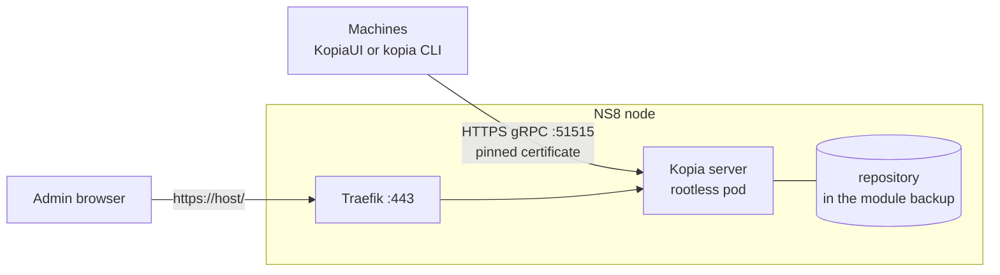

# ns8-kopia

A [Kopia](https://kopia.io) repository server for [NethServer 8](https://github.com/NethServer/ns8-core).
Your Windows, Linux and macOS machines back up to NS8 with the Kopia client or KopiaUI.
The module adds what Kopia lacks: machine accounts managed from the UI, central backup
policies, a status per machine, and mail alerts when a machine stops backing up.

One instance serves one company: ACLs keep the machines apart inside one repository.
Run several instances on one node only to host several customers, each with its own
repository, password, disk and port.



Machines connect straight to Kopia on its own port, 51515 by default, not through Traefik.
Each machine has its own account and sees only its own snapshots. It cannot delete them or
change its policies. The admin chooses what each desktop backs up.

## Documentation

- [Admin guide](docs/admin-guide.md): configure the module, enroll machines, alerts, backup
  and restore, troubleshooting.
- [User guide](docs/user-guide.md): for the person on the machine. Run the script, keep
  KopiaUI running, leave out files, restore.
- [Architecture](docs/architecture.md): network, module state, access control, timers and
  actions.

## Quick start

```sh
add-module ghcr.io/stephdl/kopia:latest 1
```

The output of the command returns the instance name, for example `kopia1`. Then fill in the
Settings page, or:

```sh
api-cli run module/kopia1/configure-module --data - <<'JSON'
{
  "host": "kopia.example.org",
  "lets_encrypt": true,
  "admin_password": "Admin-pass-2026",
  "repository_password": "Write-it-down-2026"
}
JSON
```

The repository password cannot be recovered and never changes. Without it every backup is
lost. Write it down outside the server.

Choose the host and the client port before the first machine: they cannot change while
machines exist. Then add machines on the Clients page, see
[Enroll a machine](docs/admin-guide.md#enroll-a-machine).

## Known limits

- The module certificate expires after 10 years. Every machine must be enrolled again then.
- Kopia native notification profiles verify the SMTP server certificate and have no option
  to skip it. They fail against a smarthost with a self-signed certificate. The module alerts
  do not depend on them.
- Policy actions (`--before-snapshot-root-action`) did not run in server mode in my tests.
- Kopia is younger than restic or Borg. Rare repository corruption has been reported upstream.
  The weekly `kopia content verify` reads the share of the blobs set in Policies, 10 % by
  default.
- The module cannot force a machine to back up. It only notices when one stops.

## Testing

The Robot Framework tests in [tests/](tests/) run in CI on a fresh NS8 node: install,
configure, then the node acts as its own client: it runs the enrollment script in a kopia
container, backs up, restores a file, checks the state, resets the password and checks the
old one is refused. Then it removes the module.
