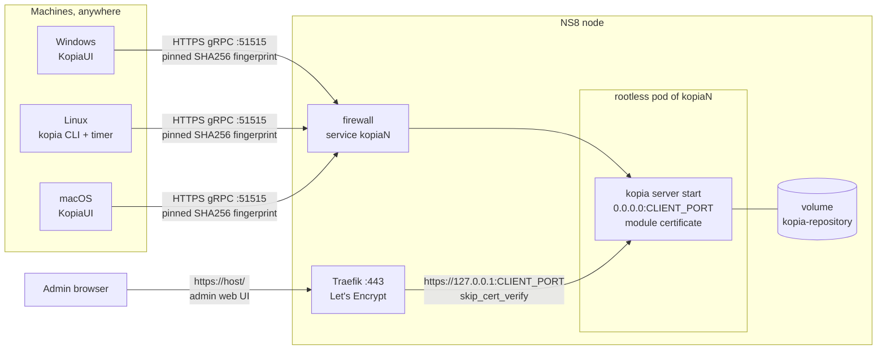
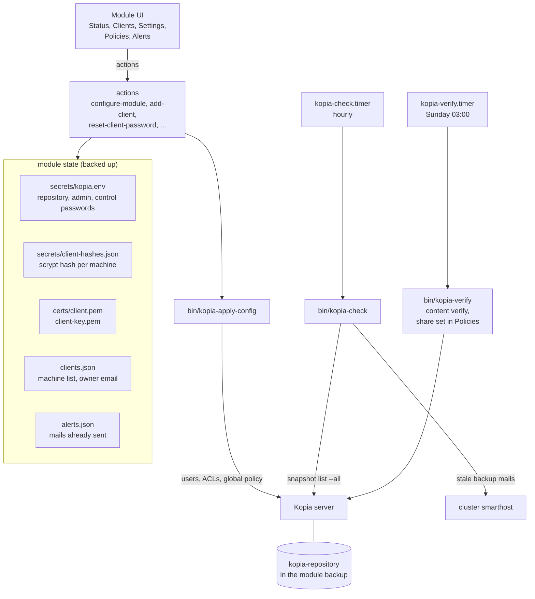
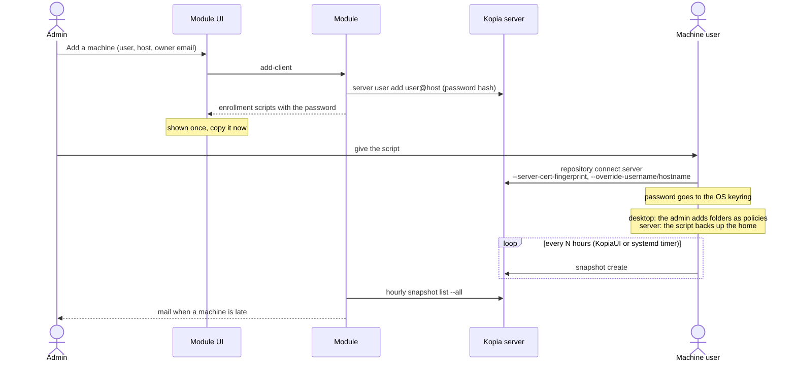

# Architecture

How ns8-kopia works inside. For the daily use of the module, see the
[admin guide](admin-guide.md).

## Network

Machines connect straight to Kopia on its own public port, 51515 by default. They never go
through Traefik: its 60 second read timeout cuts any backup longer than one minute, because
Kopia keeps one gRPC stream for the whole backup.

On that port Kopia serves TLS with a module certificate, self-signed, valid 10 years. Machines
pin its SHA256 fingerprint, so a host name change or a Let's Encrypt renewal never breaks
them. Traefik serves only the admin web UI on 443, with Let's Encrypt if you ask for it. The
same web UI also answers on the client port, behind the same admin login.

Clients only connect outbound. On the NS8 side, the module opens the client port in the
firewall. The port must be outside the NS8 port allocator range (20000 to 45000), so the
allocator never hands it to another module.

## Components

The module state is the source of truth. Kopia keeps its users in the repository, but the
repository can miss some: an account created while the backup copied the repository, or a
backup taken before the repository was in it. So `kopia-apply-config` pushes the state into Kopia:
it creates missing accounts with their stored hash, resets the ACLs if they drifted, and sets
the global policy. It never deletes an account. Only `remove-client` does that. It runs after
`configure-module`, `update-module` and a restore.

The repository is a Kopia filesystem repository in the `kopia-repository` volume. It is
created at the first `configure-module`, with the password chosen by the admin. The server
runs maintenance itself, under the fixed identity `server@kopia` set when the repository is
created, so a host change does not stop it.

When more than 3 GB are free at creation, the volume gets a 1 GB file,
`RESERVED-SPACE-delete-if-disk-full`. Deleting it gives Kopia room to finish its work when the
disk is full. A full disk can damage a filesystem repository.

### Systemd units

All units are user units of the module.

| Unit | Role |
| --- | --- |
| `kopia.service` | the rootless pod |
| `kopia-server.service` | the `kopia server start` container |
| `kopia-check.timer` | hourly, runs `bin/kopia-check`: client states, late mails, maintenance resume |
| `kopia-verify.timer` | Sunday 03:00, runs `bin/kopia-verify`: weekly integrity check |
| `kopia-verify-snapshots.service` | started after a restore, runs `bin/kopia-verify --snapshots` |

## Machines

Each machine has its own account `user@host` and its own random password. The module keeps
only the scrypt hash of that password. The password appears once, inside the enrollment
script returned when the machine is added or its password reset. The core keeps that task
output for about 8 hours, readable by cluster admins only. They can read the repository
password anyway.

A reset gives the same identity a new password. The machine finds its old snapshots after it
runs the new script. Until then, the old password in its keyring stops working.

### Access control

Default ACLs: a machine sees and creates only its own snapshots, and cannot delete any. It
reads its policies, the host policy and the global policy. It can append content to the
repository, which every backup needs. It cannot change any policy or its own account.

This is why a desktop cannot pick its own folders. In KopiaUI, **New Snapshot** writes a
policy, and the machine only reads its policies. The admin creates a policy for each folder
instead, and KopiaUI snapshots every folder that has a policy.

Old snapshots still expire: after each snapshot the machine asks the server to apply the
retention of the policy, and the server deletes them. A machine that stops backing up keeps
its last snapshots.

Anyone holding the script can read and restore the backups of that machine, from anywhere,
but not delete them directly. This is no full guard: a machine sets the time of its own
snapshots, so a stolen script can create fake ones that push the real ones out of the
retention. The cluster backup, with its own retention, is the fallback.

The ACLs protect the policies in the repository, not the machine itself. Its user can still
leave out any folder with a `.kopiaignore` file, which never goes through the server. The
same user can also stop KopiaUI or disconnect from the repository. The module cannot force a
machine to back up, it can only notice it.

## Alerts

`kopia-check` runs every hour and computes the age of the newest complete snapshot of each
machine. A machine that never backed up counts from the day its account was created. A
desktop backs up nothing until the admin adds folders, so a machine left without folders
gets the late mails too, as expected.

It records each mail sent in `alerts.json`, so one mail goes out when a threshold is crossed,
never one per run. A machine that comes back from the admin level to the owner level gets no
mail: it backed up once, but it is still late.

Mails go through the cluster smarthost, from `noreply@<host>` unless a sender is set. Kopia
native notification profiles are not used: they verify the SMTP server certificate and fail
against a smarthost with a self-signed one.

## Integrity check

`kopia-verify` runs every Sunday at 03:00. It always checks the index and that every pack
exists, then downloads and checks the share of data set in `verify_percent`. It stops after
6 days and 23 hours, just before the next weekly run, and records the run as not finished.

With `--snapshots` it walks every snapshot tree instead (`kopia snapshot verify`). This runs
once after a restore: a snapshot that ended while the backup copied the repository can miss
data in the restored copy, and only a walk of the snapshots finds it.

## Backup and restore

The module backup holds `state/secrets`, `state/certs`, `state/clients.json`,
`state/alerts.json` and the `kopia-repository` volume
([state-include.conf](../imageroot/etc/state-include.conf)). It leaves out the reserved space
file and the `*.tmp.*` blobs Kopia is still writing
([state-exclude.conf](../imageroot/etc/state-exclude.conf)).

Kopia maintenance rewrites indexes and deletes packs, which would break restic while it reads
the volume. So `module-dump-state` pauses the maintenance before the backup and
`module-cleanup-state` resumes it after. If the backup fails before the cleanup, `kopia-check`
resumes a pause older than 24 hours. The machines keep backing up during the backup: Kopia
packs never change once written.

`restore-module` restores the state and the volume, then `kopia-apply-config` creates the
machine accounts again from their hashes, and `kopia-verify-snapshots.service` checks every
snapshot. The client port is kept: when another instance on the node holds it, the restored
instance stays stopped. `clone-module` follows the same rule.

## Actions

| Action | Purpose |
| --- | --- |
| `create-module` | generate the secrets and the module certificate |
| `configure-module` | settings, then repository creation and `kopia-apply-config` |
| `get-configuration` | settings, never a password |
| `add-client` | create `user@host`, return the scripts with the password |
| `reset-client-password` | new password, return the new scripts |
| `get-client-enrollment` | URL, fingerprint and identity, without the password |
| `list-clients` | machines with last backup and state: `ok`, `late`, `late_admin`, `never_seen`, or `unknown` when the server does not answer |
| `list-client-folders` | folders of a machine, with the date of their last snapshot |
| `remove-client` | remove the account, and its snapshots with `delete_snapshots` |
| `count-snapshots` | count the snapshots left for a `user@host`, before it is added again |
| `get-health` | server, disk use, certificate expiry, last integrity check |
| `get-repository-password` | show the repository password |
| `send-test-mail` | send a test mail to `recipient` through the smarthost |
| `restore-module` | restore the state, recreate the accounts, check the snapshots |
| `clone-module` | start a cloned instance unless its port is taken |
| `destroy-module` | close the client port in the firewall |

Each action validates its input with a `validate-input.json` next to it. All configuration
fields are in [configure-module/validate-input.json](../imageroot/actions/configure-module/validate-input.json).
